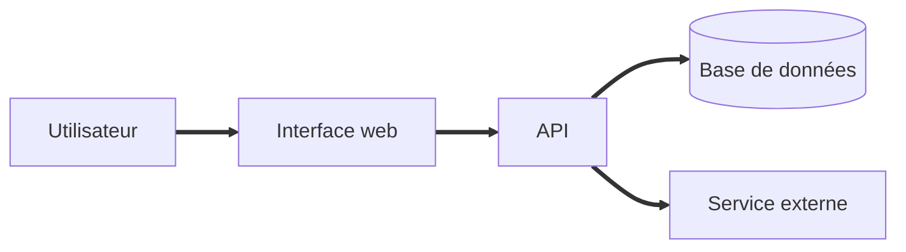
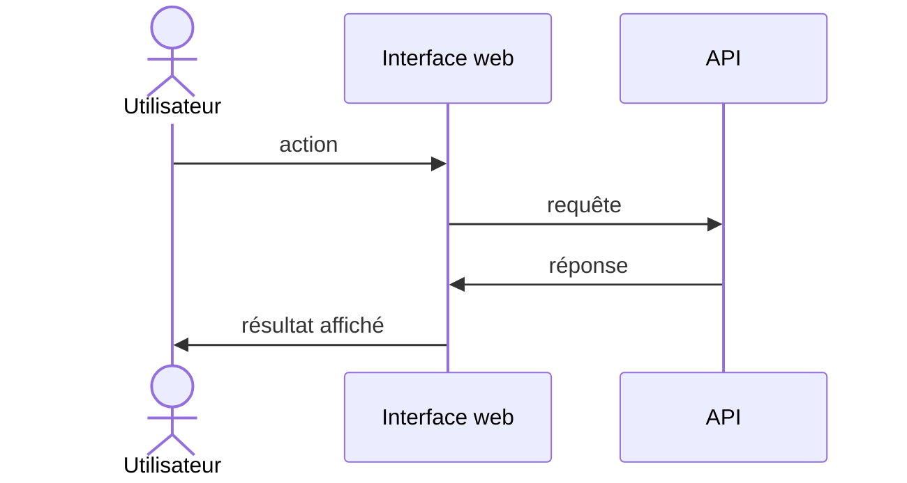

# Architecture : <nom du produit>

<!-- Ce document décrit la structure technique de la solution. Il respecte le CSR (Cadre de Référence)
     du projet. Chaque choix important donne lieu à un ADR (docs/architecture/adr/). -->

## Vue d'ensemble

<!-- Un paragraphe : quels sont les grands morceaux (interface, API, base de données, services externes) ? -->

## Schéma

<!-- Schéma simple (texte, Mermaid ou image). Montre les composants et les flux principaux. -->

```text
[Utilisateur] -> [Interface web] -> [API] -> [Base de données]
```

<!-- Diagrammes Mermaid, facultatifs : GitHub et GitLab les affichent directement (pas tous les éditeurs).
     Pour en utiliser un, sors-le de ce commentaire et remplace les noms par ceux de tes vrais composants.
     (Ici les liens utilisent « ==> » : la flèche à deux tirets fermerait ce commentaire HTML.)

     Flux :


     Séquence d'un cas d'usage clé :

-->

## Composants

| Composant | Rôle | Technologie (conforme au CSR) |
|---|---|---|
|  |  |  |

## Données

<!-- Principales entités métier, où elles sont stockées, durée de conservation, données personnelles concernées. -->

## Intégrations externes

<!-- Services tiers, API externes, authentification. Indique le mode de connexion et ce qui est échangé. -->

| Service | Usage | Données échangées |
|---|---|---|
|  |  |  |

## Sécurité et confidentialité

<!-- Authentification, droits d'accès, chiffrement, gestion des secrets (jamais dans le code ni dans ce document). -->

- 

## Exploitation

<!-- Hébergement, déploiement, supervision, sauvegardes, environnements (dev, test, prod). -->

- 

## Décisions d'architecture

<!-- Liste des ADR liés à ce document. -->

| ADR | Titre | Statut |
|---|---|---|
|  |  |  |

## Risques techniques

<!-- Dette, points de fragilité, dépendances critiques. -->

- 
