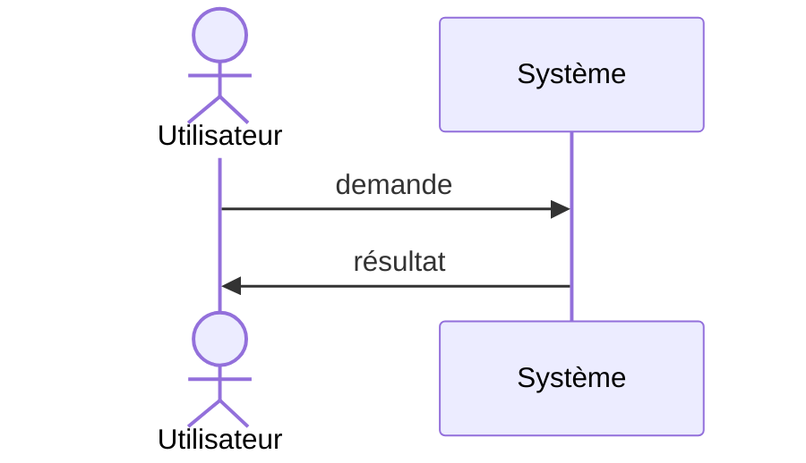

# EPIC-XXX : <titre de l'épic>

<!-- Un épic regroupe plusieurs user stories qui servent le même objectif métier.
     Un épic doit être livrable par morceaux : chaque story apporte de la valeur seule. -->

## Objectif

<!-- Une ou deux phrases : quelle valeur métier cet épic apporte, pour quel utilisateur ? -->

## Périmètre

### Inclus

- 

### Exclu

- 

## Critères de succès de l'épic

<!-- Comment saura-t-on que l'épic est terminé et utile ? Un ou deux critères mesurables. -->

- 

<!-- Flux ou séquence de l'epic en Mermaid, facultatif : GitHub et GitLab l'affichent directement (pas tous
     les éditeurs). Sors-le de ce commentaire et adapte-le. Ici les messages utilisent « ->> » : la flèche
     à deux tirets fermerait ce commentaire HTML.

-->

## User stories

<!-- Liste des stories de l'épic. Les identifiants viennent du backlog (backlog/tasks/). -->

| ID | Titre | Statut |
|---|---|---|
| US-XXX |  | À faire |

## Dépendances

<!-- Autres épics ou décisions (ADR) nécessaires avant de commencer. -->

- 

## Risques et questions ouvertes

- 
