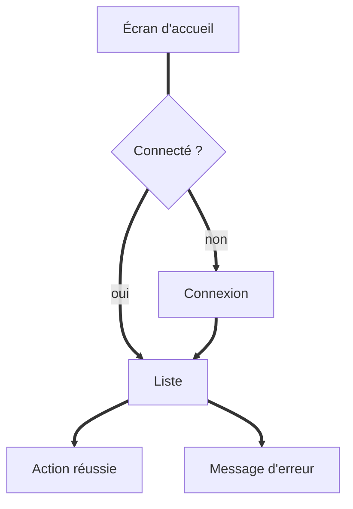

# UX : <nom du produit>

<!-- Ce document décrit comment l'utilisateur vit le produit : parcours, écrans, états, accessibilité.
     Il part du PRD validé. Décris le comportement attendu, pas le code. -->

## Parcours utilisateur

<!-- Un parcours = une suite d'étapes qu'un persona suit pour atteindre un objectif. -->

### Parcours 1 : <objectif de l'utilisateur>

1. <étape 1>
2. <étape 2>
3. <étape 3>

<!-- Pour chaque étape, indique ce que voit l'utilisateur et ce qu'il peut faire. -->

<!-- Diagramme Mermaid du parcours, facultatif : GitHub et GitLab l'affichent directement (pas tous les
     éditeurs). Sors-le de ce commentaire et adapte-le. Ici les liens utilisent « ==> » : la flèche
     à deux tirets fermerait ce commentaire HTML.

-->

## Écrans

<!-- Un écran par bloc. Décris le contenu, les actions possibles et les états. -->

### Écran : <nom de l'écran>

- **But** : 
- **Contenu** : 
- **Actions** : 
- **Retour attendu après action** : 

## États et messages

<!-- Chaque écran a des états : chargement, vide, succès, erreur. Écris les messages en français simple. -->

| Situation | Message affiché à l'utilisateur |
|---|---|
| Chargement |  |
| Liste vide |  |
| Erreur réseau |  |

## Accessibilité

<!-- Référentiel visé (RGAA, WCAG 2.1 AA). Contrastes, navigation clavier, libellés des champs, textes alternatifs. -->

- 

## Maquettes

<!-- Liens vers les maquettes (Figma, images dans docs/produit/maquettes/). Un lien par écran clé. -->

- 

## Points à valider

<!-- Choix d'interface qui demandent l'avis du humain (PO, utilisateurs). Propose 2 ou 3 options si possible. -->

- 
